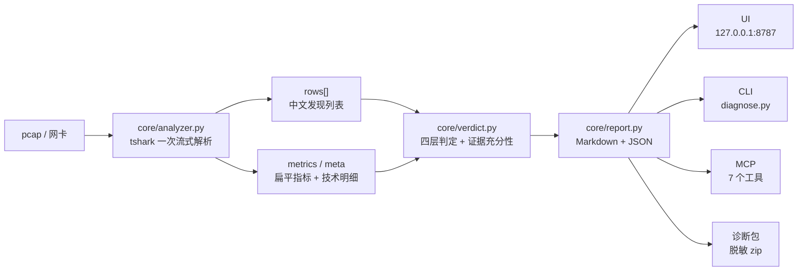

<p align="center">
  
</p>

<h1 align="center">NetDiag · 网络矩阵</h1>

<p align="center">四层定位的便携网络诊断工具 —— 说清楚是哪一层坏了，而不是只告诉你“网慢”</p>

<p align="center">
  <a href="https://github.com/ftwvvt74r6-cloud/usb-net-diag/actions/workflows/smoke.yml"></a>
  
  
  
  
  
</p>

**NetDiag（网络矩阵）** 是一个 Windows 便携网络诊断工具：抓一段包，或对单个目标做一次连通与速度测试，
把“慢、卡、丢包、连不上、时通时不通”定位到 **L2 链路 → L3 网络 → L4 传输 → L7 应用** 的某一层，
并回答四个问题：**哪一层坏了 / 哪个协议 / 哪个对端 / 下一步做什么**。

- **L2–L7 四层定位**：每层都给出结论、指标和帧号证据，而不是一句“网络异常”。
- **结论自带依据与边界（六出口一致）**：UI / CLI / 报告 / 诊断包 / 取证单 / MCP 共用同一结论对象；
  「复制给协作方」和导出整块包含依据、本次覆盖、明确未覆盖与置信等级，不是只给一句结论
  （见 [`docs/conclusion-boundary.md`](docs/conclusion-boundary.md)）。
- **重传方向归因**：有 dup-ACK 证据时才判定上行 / 下行丢包；证据不足不硬编方向。
- **证据不足就说证据不足**：没抓到样本 ≠ 网络正常，四层状态里会明确显示“无样本”。

## 它解决什么问题

| 常见做法 | 盲区 | NetDiag 的做法 |
|---|---|---|
| `ping` 通就说网络没问题 | 只证明 ICMP，不证明 TCP 握手、DNS、HTTP 是否正常 | 按 L2–L7 分别取证，再自下而上判定 |
| 看到重传就说“丢包了” | 不知道丢在上行还是下行，排查方向靠猜 | 只在 dup-ACK 证据成立时给方向；否则只报重传事实 |
| 抓包工具丢给你几万行字段 | 需要专家才能读出结论，普通人看完更迷茫 | 输出「一句话结论 + 四层状态 + 问题详解 + 处置步骤」 |
| 没抓到包也显示“正常” | 把“没有样本”误判成“没有问题” | 证据充分性闸门：无样本时返回「证据不足」 |
| 日志/诊断包直接发回来 | 内网 IP、域名、用户名跟着泄漏 | 诊断包默认脱敏，并在写 zip 前做泄漏自检 |


## 五种模式（它回答什么问题）

| 模式 | 技术名 | 副标题 / 它回答什么问题 | 输入 |
|---|---|---|---|
| **全网体检** | 全网扫描 | 抓本机所有流量，看整体状况 | 网卡 + 时长 |
| **单目标诊断** | 定向抓包 | 只看我和某个 IP/网站的通信，判断卡在哪一环 | 网卡 + 目标 + 时长 |
| **通信观察** | 被动监听 | 不发包，只看谁在和谁通信 | 网卡 + 时长 |
| **连通与速度测试** | 链路体检 | 主动探测，10 秒给出通不通、多快 | 目标地址 |
| **分析抓包文件** | 离线分析 | 别人抓的/之前存的 pcap，导入分析 | pcap 文件 |

> 括号里的旧名是技术名，老用户和文档可以继续按它搜索。

## 真实产物

下面这段逐字截取自仓库内的真实报告 [`reports/faults_demo.md`](reports/faults_demo.md)（第 10–26 行）。
样本 `captures/faults_demo.pcap` 是人工构造的故障包：16.0 秒、54 个报文、4 个 TCP 会话，
同时包含 ARP 无应答、DNS 慢解析与 NXDOMAIN、TCP 建连无响应、重传、HTTP 500 与 2.4 秒慢响应、
ICMP 端口不可达。

```markdown
## 一、故障定位

### ❌ 1 个目标端口完全连不上：TCP 握手没有回应

**故障层**：L4 传输层｜TCP　**影响**：业务不可用：相关服务连不上

表现是：访问这个地址时一直转圈，最后提示「无法连接」或连接超时。网络本身可能是通的，卡在「建立连接」这一步 —— 要么对方端口没有服务在听，要么中间的防火墙/安全组把包丢了。
定位：1 个连接发出 SYN 后始终没有收到回应，TCP 三次握手未完成

### 分层定位

| 层次 | 协议 | 状态 | 关键指标 |
|---|---|---|---|
| L2 本地链路 | ARP / 以太网 | ⚠️ 注意 | ARP 无应答 1 个地址 |
| L3 网络层 | IP / ICMP | ⚠️ 注意 | RTT 均值 54ms，抖动 62ms，ICMP 异常 1 条 |
| L4 传输层 | TCP / UDP | ❌ 异常 | 重传率 5.56%，建连失败 1，握手均值 63ms |
| L7 应用层 | DNS / HTTP / TLS | ❌ 异常 | DNS 均值 385ms，HTTP 均值 1210ms |
```

> 以上内容没有改写、没有补写；完整报告见 [`reports/faults_demo.md`](reports/faults_demo.md)，
> 机器可读版本见 [`reports/faults_demo.json`](reports/faults_demo.json)。

分层结论一眼看：

| 层次 | 报告状态 | 关键证据 |
|---|---|---|
| L2 本地链路 | ⚠️ 注意 | ARP 无应答 1 个地址（192.168.1.50） |
| L3 网络层 | ⚠️ 注意 | RTT 均值 54ms、抖动 62ms、ICMP 端口不可达 1 条 |
| L4 传输层 | ❌ 异常 | 建连失败 1（10.0.0.5:8080）、重传率 5.56% |
| L7 应用层 | ❌ 异常 | DNS 失败率 29%、HTTP 500 占 50%、HTTP 均值 1210ms |
| **结论** | **严重 3 / 警告 5** | **故障层 L4 传输层｜TCP** |

## 架构与数据流



一行版本：

```text
tshark → rows[] + metrics/meta → verdict → report → UI / CLI / MCP / 诊断包
```

四个入口共用同一套判定与报告：UI 是单文件控制台；CLI 适合脚本化；
MCP 暴露 7 个 stdio 工具给 Agent；诊断包把日志和报告脱敏后打包，方便离线收集。

## 快速开始

### ① 源码运行（有 Python 即可）

```bat
git clone https://github.com/ftwvvt74r6-cloud/usb-net-diag.git
cd usb-net-diag
python core\server.py
```

浏览器打开 `http://127.0.0.1:8787/`。没有 pip 依赖，不需要 `pip install`。
分析抓包文件需要 tshark（安装 Wireshark，或把 `TSHARK_PATH` 指向 `tshark.exe`）：

```bat
python core\diagnose.py --pcap captures\faults_demo.pcap --report-out %TEMP%\netdiag-demo
```

启动器会按 **① `tools\python\pythonw.exe` / `python.exe` → ② 系统 `python` → ③ `py -3`** 的顺序找运行时；
都没有时会给出明确提示和 Python 官网链接。源码目录没有 `tools/`，因此自动走 ② / ③。

### ② 公开 lite 包（需自装 Python / Wireshark）

v0.3.1 **已发布**：从 [Release v0.3.1](https://github.com/ftwvvt74r6-cloud/usb-net-diag/releases/tag/v0.3.1)
下载 `NetDiag-0.3.1-lite.zip`（**174 个文件 / 1,031,112 B / 解压后 2,771,469 B /
SHA-256 `09fc93f463c82724a6a1a5ceabe85ea76b438e3549eee2e51303a7bc87ac8d53`**，同页附
`SHA256SUMS.txt`），解压后**推荐直接双击 `NetDiag.exe`**
（首次运行先做五项准备检查，之后直接进主界面）；需要排障时再用下面的命令：

```bat
自检.bat
python core\server.py
```

lite 包**不含**便携 Python、Wireshark、Npcap；包内 `NetDiag.exe` 是构建时用系统 csc 编译的启动器，
**双击不请求提权**，实时抓包 / 通信观察在界面里按需提权。需要 Python 3.11+；分析抓包文件另装
Wireshark；全网体检 / 单目标诊断 / 通信观察另装 Npcap。`自检.bat` 会逐项告诉你缺什么、去哪装；
启动、提权与首屏自检的细节见 [`docs/startup.md`](docs/startup.md)。

### ③ internal 包（自带运行时，双击即用）

维护者用发布脚本构建内部包：

```bat
python scripts\build_release.py --with-tools
python scripts\build_release.py --with-npcap
```

`--with-tools` 内含便携 Python 3.11.9 + Wireshark 4.7.4（tshark）；`--with-npcap` 另含
Npcap 安装器。双击 `NetDiag.vbs`（兼容，无黑窗）或 `start.bat`（带窗口）即可启动；
启动不提权，实时抓包 / 通信观察会在界面按需请求管理员权限。lite 包提供 `NetDiag.exe`
双击入口（见 [`docs/startup.md`](docs/startup.md)）。
**公开仓库 / 公开 Release 只发 lite 代码包，永远不带 Npcap / Wireshark / Python 二进制**，
原因见 [`docs/licensing.md`](docs/licensing.md)。

| 能力 | 依赖 | 说明 |
|---|---|---|
| 分析抓包文件（pcap） | tshark | 不需要 Npcap / 管理员 |
| 连通与速度测试（单目标 TCP） | 无 | 纯标准库 socket |
| 全网体检 / 单目标诊断 / 通信观察 | Npcap + 管理员 | Windows 驱动，无法免安装 |

## 工程严谨性

| 项目 | 实测值 | 出处 / 复现方式 |
|---|---|---|
| 自动化测试 | **722** 项；本机 `OK (skipped=2)`，干净 checkout `OK (skipped=27)` | `python -m unittest discover -s tests` |
| 测试文件 | **35** 个（34 个 `test_*.py` + `selftest.py`） | `git ls-files 'tests/*.py'` |
| CI | **2 个 job**：Windows 语法 + 启动器契约；Ubuntu 注释覆盖率 + 文档同步 | [`.github/workflows/smoke.yml`](.github/workflows/smoke.yml) |
| 注释覆盖率 | **302 / 302 = 100.0%**，33 个模块 | `python scripts/gen_api_doc.py --check 0.95` |
| 判定可复现 | demo + 9 个确定性样本 = **20 / 20** 个产物逐字节相同 | `captures/faults_demo.pcap` + `scaffold/tests/fixtures/gen_pcap.py` |
| API 契约 | **12 个 POST + 13 个 GET** 核心路由 | [`core/server.py`](core/server.py) / [`docs/HANDOVER-AI.md`](docs/HANDOVER-AI.md) §4 |
| 发布包 | v0.3.1 lite：**174 个文件 / 1,031,112 B**（解压后 2,771,469 B） | [`docs/release-v0.3.1.md`](docs/release-v0.3.1.md) §2–§3 |
| MCP | **7** 个工具，零第三方依赖 | [`mcp/wireshark-mcp/server.py`](mcp/wireshark-mcp/server.py) 的 `TOOLS` |
| 运行时依赖 | 核心 **0 个 pip 依赖**（仅标准库） | 源码 import 检查；CI 不装第三方包 |

**变异测试纪律**：新用例先红后绿；关键判定至少做一次变异验证——把实现故意改坏，
对应用例必须变红，再改回。方向归因、证据充分性、版本号 BOM 处理都有独立回归用例
（`tests/test_direction_signals.py`、`tests/test_sufficiency.py`、`tests/test_app_version.py`）。

**基线不变量**：任何判定改动都必须让 demo + 9 样本的 20 个产物逐字节不变；
`reports/` 是入库快照，测试只写临时目录；测试只增不减，不许用放宽断言的方式让红变绿。

## 隐私与安全

- **主流程不联网**：分析、判定、报告全部在本地完成，不上传 pcap / 日志 / 报告。
  只有你主动配置「AI 解读」或威胁情报（AbuseIPDB）时，才会访问对应外部端点。
- **诊断包默认脱敏**：IP、域名、用户名、MAC、路径替换为不可还原的稳定伪名；
  写 zip 前逐个条目扫描，只要还出现原值就抛异常、**不写出 zip**；`--raw` 才保留原值且双重警告。
- **公开包不含第三方二进制**：公开 Release 只发 lite 代码包，不含 Npcap / Wireshark / Python；
  Npcap 免费版不允许对外再分发，内部 `--with-npcap` 包仅限组织内部使用。
- **已修 keep-alive 请求走私**：早退前先丢弃请求体；chunked 请求优先判断
  `Transfer-Encoding`，无法安全 drain 时直接关闭连接，避免残留字节被解析成下一条请求。
- **只监听本机**：HTTP 服务绑定 `127.0.0.1`，并校验 `Host` / `Origin`；上传与 JSON body 有体积上限。

## 目录结构

```text
NetDiag/
├── NetDiag.exe                  # lite 包入口（构建产物，不入库；源码在 launcher/）
├── start.bat / NetDiag.vbs      # Python 回退 / 兼容入口：优先包内 Python，回退系统 python / py -3
├── core/                        # 32 个 Python 模块：采集 / 解析 / 判定 / 报告 / 服务
├── ui/index.html                # 单文件控制台（无构建链、无前端框架）
├── mcp/wireshark-mcp/server.py  # MCP stdio 服务，7 个工具
├── scripts/                     # 发布打包 / 启动器编译 / API 文档生成 / 特征导出 / 图标生成
├── tests/                       # 35 个测试文件，722 条用例
├── captures/faults_demo.pcap    # 首次试跑样本
├── reports/faults_demo.md|json  # 入库报告快照
├── docs/                        # 交接、API、日志、许可、构建、发布记录
├── config/                      # 端口 / AI / MCP 配置（真实 Key 与本地配置不入库）
└── scaffold/                    # v0.1.0 迁移骨架与 9 个确定性样本生成器
```

## 文档索引

| 文档 | 内容 |
|---|---|
| [`docs/HANDOVER-AI.md`](docs/HANDOVER-AI.md) | 现状、数据流、对外 API、红线、开发流程（交接首选） |
| [`AGENTS.md`](AGENTS.md) | AI 协作硬约束与目录职责 |
| [`docs/logging.md`](docs/logging.md) | 日志目录、字段、轮转与保留策略 |
| [`docs/log-collection.md`](docs/log-collection.md) | 诊断包三个入口、脱敏规则、raw 警告 |
| [`docs/build.md`](docs/build.md) | lite / internal / internal-npcap 三种包怎么构建与验包 |
| [`docs/startup.md`](docs/startup.md) | 三个启动入口、启动不提权、按需提权权限卡、首屏自检、常见启动失败 |
| [`docs/licensing.md`](docs/licensing.md) | 第三方许可、公开/内部分发边界 |
| [`docs/api-reference.md`](docs/api-reference.md) | 自动生成的公开符号与签名（禁止手改） |
| [`docs/release-v0.3.1.md`](docs/release-v0.3.1.md) | v0.3.1 发布资产、包内容、构建自检、红线证据与干净 checkout |
| [`docs/release-v0.3.0.md`](docs/release-v0.3.0.md) | v0.3.0 发布资产、包内容、构建自检与红线证据（历史） |
| [`docs/release-v0.2.0.md`](docs/release-v0.2.0.md) | v0.2.0 发布资产、包内容与红线证据（历史） |

## Roadmap

- [x] **v0.3.1**：结论与边界（`confidence` / `basis` / `coverage` / `not_covered`，六出口一致）/ E 批次
- [x] **v0.3.0**：UI 2.0 / B2 命名与反馈 / B3 清尾修复与联动 / D+ 路径剖面与取证 / C 启动体验（`NetDiag.exe`、按需提权、首屏自检）
- [x] **v0.2.0**：四层定位、方向归因、证据充分性、诊断包脱敏、品牌与发布
- [ ] 报告模板可定制
- [ ] 判定阈值可配置
- [ ] 跨平台抓包支持（Linux / macOS）

## License

本项目源代码采用 [MIT License](LICENSE)，Copyright (c) 2026 **NetDiag contributors**。

第三方组件（Wireshark、Npcap、Python、Scapy）不适用 MIT，各有自己的许可与再分发边界，
详见 [`docs/licensing.md`](docs/licensing.md)。公开 Release 只发不含第三方二进制的 lite 代码包。
